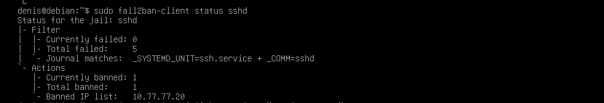
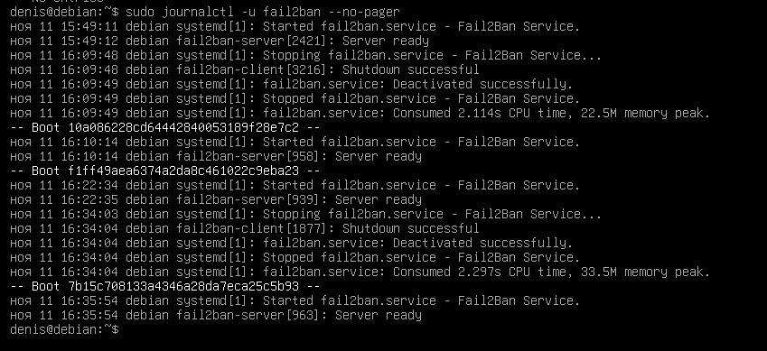

# Домашнее задание к занятию «Защита сети»


## Подготовка к выполнению заданий
Подготовка защищаемой системы:
установите Suricata,
установите Fail2Ban.
Подготовка системы злоумышленника: установите nmap и thc-hydra либо скачайте и установите Kali linux.
Обе системы должны находится в одной подсети.

### Задание 1
Проведите разведку системы и определите, какие сетевые службы запущены на защищаемой системе:
```
sudo nmap -sA < ip-адрес >

sudo nmap -sT < ip-адрес >

sudo nmap -sS < ip-адрес >

sudo nmap -sV < ip-адрес >
```
По желанию можете поэкспериментировать с опциями: https://nmap.org/man/ru/man-briefoptions.html.

В качестве ответа пришлите события, которые попали в логи Suricata и Fail2Ban, прокомментируйте результат.


```
В ходе проверки видим, что Kali (10.77.77.20)обменивается сетевыми пакетами с защищаемой Debian (10.77.77.10).

1. Что обнаружила Suricata

Suricata записала сетевые обращения Kali к различным портам Debian: 5009, 4343, 5952, 50500, 1998, 1999, 3689, 5903, 5678, 1071, 10000, 6106 и другим.

Это означает, что система видит попытки подключения к разным сетевым портам и сохраняет информацию о них.

2. Что означают TCP-флаги

В журнале встречаются SYN, ACK и RST:
- SYN — Kali пытается установить соединение.
- ACK — подтверждение или проверка состояния соединения.
- RST — соединение сбрасывается или отклоняется.
Таким образом, Suricata фиксирует попытки сетевого взаимодействия и ответы защищаемой системы.

3. Почему alerted: false

Это означает, что Suricata записала сетевой обмен, но не обнаружила для него совпадения с правилом, которое должно сформировать тревогу.

То есть сканирование видно в журнале, но отдельного предупреждения IDS по этим соединениям не возникло.

4. Что произошло с Fail2Ban

Ожидаемый результат: ничего. Fail2Ban реагирует на повторяющиеся неудачные попытки аутентификации (парсит логи конкретных служб — sshd, apache и т.д.), а не на сетевое сканирование портов как таковое. Nmap не генерирует записей в /var/log/auth.log, поэтому Fail2Ban не видит эту активность вообще.

Вывод по заданию 1: Suricata (IDS) работает на уровне сети/пакетов и способна детектировать сам факт и тип сканирования портов по сигнатурам аномального трафика; Fail2Ban работает на уровне логов приложений и реагирует только на события аутентификации — сканирование портов для него «невидимо». Это демонстрирует разницу между network-based IDS и host-based protection, завязанной на логи.
```


### Задание 2
Проведите атаку на подбор пароля для службы SSH:
```
hydra -L users.txt -P pass.txt < ip-адрес > ssh
```
Настройка hydra:
создайте два файла: users.txt и pass.txt;
в каждой строчке первого файла должны быть имена пользователей, второго — пароли. В нашем случае это могут быть случайные строки, но ради эксперимента можете добавить имя и пароль существующего пользователя.
Дополнительная информация по hydra: https://kali.tools/?p=1847.
```
Включение защиты SSH для Fail2Ban:
открыть файл /etc/fail2ban/jail.conf,
найти секцию ssh,
установить enabled в true.
Дополнительная информация по Fail2Ban:https://putty.org.ru/articles/fail2ban-ssh.html.
```
В качестве ответа пришлите события, которые попали в логи Suricata и Fail2Ban, прокомментируйте результат.

Вывод по заданию 2: в отличие от сканирования портов, брутфорс SSH оставляет чёткий след в /var/log/auth.log, который Fail2Ban активно парсит и на который реагирует блокировкой — это пример host-based защиты, эффективной именно против атак на аутентификацию. Suricata здесь выступает дополнительным, более «сырым» индикатором на уровне сетевого трафика, но основную защитную функцию выполняет именно Fail2Ban.





