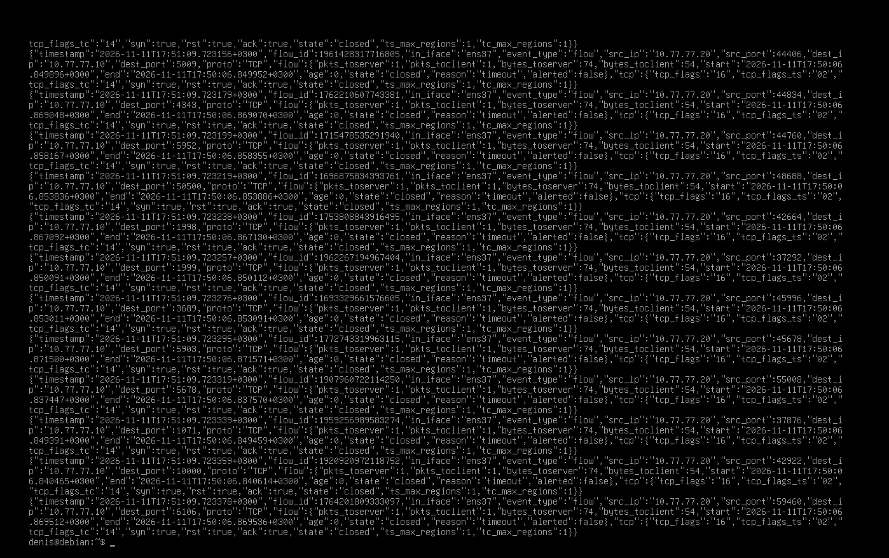
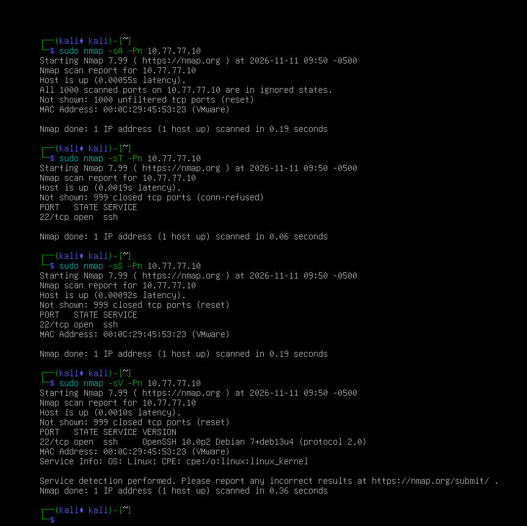

# Домашнее задание к занятию «Защита сети»


## Подготовка к выполнению заданий
Подготовка защищаемой системы:
установите Suricata,
установите Fail2Ban.
Подготовка системы злоумышленника: установите nmap и thc-hydra либо скачайте и установите Kali linux.
Обе системы должны находится в одной подсети.

### Задание 1
Проведите разведку системы и определите, какие сетевые службы запущены на защищаемой системе:
```
sudo nmap -sA < ip-адрес >

sudo nmap -sT < ip-адрес >

sudo nmap -sS < ip-адрес >

sudo nmap -sV < ip-адрес >
```
По желанию можете поэкспериментировать с опциями: https://nmap.org/man/ru/man-briefoptions.html.

В качестве ответа пришлите события, которые попали в логи Suricata и Fail2Ban, прокомментируйте результат.



```
В ходе проверки мы увидели, что Kali (10.77.77.20) успешно обменивается сетевыми пакетами с защищаемой Debian (10.77.77.10).

1. Что обнаружила Suricata

Suricata записала сетевые обращения Kali к различным портам Debian: 5009, 4343, 5952, 50500, 1998, 1999, 3689, 5903, 5678, 1071, 10000, 6106 и другим.

Это означает, что система видит попытки подключения к разным сетевым портам и сохраняет информацию о них.

2. Что означают TCP-флаги

В журнале встречаются SYN, ACK и RST:
- SYN — Kali пытается установить соединение.
- ACK — подтверждение или проверка состояния соединения.
- RST — соединение сбрасывается или отклоняется.
Таким образом, Suricata фиксирует попытки сетевого взаимодействия и ответы защищаемой системы.

3. Почему alerted: false

Это означает, что Suricata записала сетевой обмен, но не обнаружила для него совпадения с правилом, которое должно сформировать тревогу.

То есть сканирование видно в журнале, но отдельного предупреждения IDS по этим соединениям не возникло.

4. Что произошло с Fail2Ban

Пока нет подтверждения, что Fail2Ban заблокировал Kali. Это нормально: Fail2Ban в нашей лаборатории следит прежде всего за неудачными попытками входа по SSH, а не за обычным сканированием портов.
Общий вывод для отчёта
В ходе лабораторной работы была проведена проверка защищаемой системы Debian с помощью Nmap. Suricata успешно обнаружила сетевую активность от Kali и записала обращения к различным TCP-портам. В журналах присутствовали TCP-флаги SYN, ACK и RST, что свидетельствует о попытках установления, проверки и сброса соединений.

При этом alerted: false показывает, что правила Suricata не сформировали предупреждений для зафиксированных потоков. Fail2Ban также не обязан блокировать адрес Kali при обычном сканировании, поскольку его задача в данной конфигурации — защита SSH от неудачных попыток авторизации.
```


### Задание 2
Проведите атаку на подбор пароля для службы SSH:
```
hydra -L users.txt -P pass.txt < ip-адрес > ssh
```
Настройка hydra:
создайте два файла: users.txt и pass.txt;
в каждой строчке первого файла должны быть имена пользователей, второго — пароли. В нашем случае это могут быть случайные строки, но ради эксперимента можете добавить имя и пароль существующего пользователя.
Дополнительная информация по hydra: https://kali.tools/?p=1847.
```
Включение защиты SSH для Fail2Ban:
открыть файл /etc/fail2ban/jail.conf,
найти секцию ssh,
установить enabled в true.
Дополнительная информация по Fail2Ban:https://putty.org.ru/articles/fail2ban-ssh.html.
```
В качестве ответа пришлите события, которые попали в логи Suricata и Fail2Ban, прокомментируйте результат.
